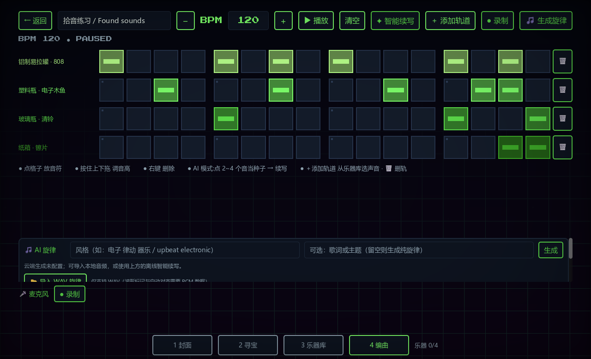
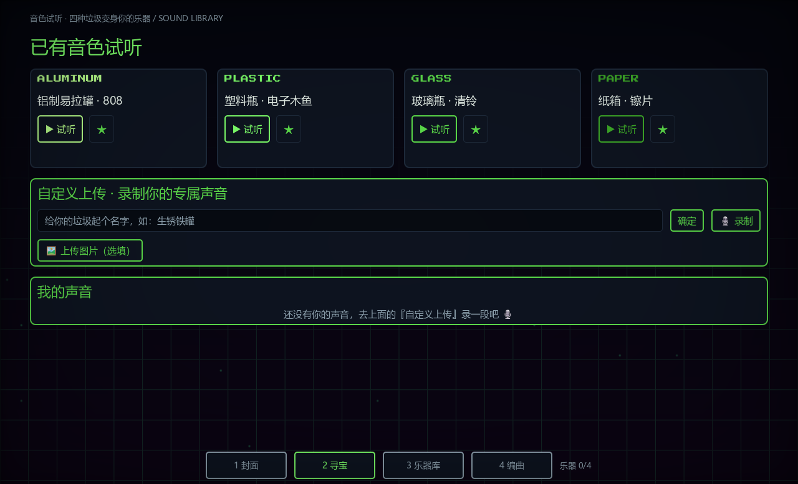

# TrashBeats · 拾音

**把日常物件的声音做成乐器，再拼出自己的节奏。**

TrashBeats 是一个用 Godot 制作的音乐交互原型，来自 MTX 音乐交互线上 1 组。敲一敲罐子或纸箱，录成短音色，放进节奏网格；也可以先用内置音色开始创作。

[Windows 试玩版](https://github.com/L1xy6/Trashbeats/releases) · [English](docs/README.en.md) · [运行与构建](docs/BUILDING.md) · [反馈问题](https://github.com/L1xy6/Trashbeats/issues)



> **当前状态：课程原型，界面为中文。** 预置音色、节奏编排和智能续写可离线使用，无需账号或 API 密钥。云端生成旋律是可选功能，需要使用者自己的天琴接口权限。

## 先做一段节奏

1. 下载 [Releases](https://github.com/L1xy6/Trashbeats/releases) 中的 Windows ZIP，解压后运行 `Trashbeats.exe`。
2. 点底部 **「编曲」→「新建编曲」**，选择 **4/4 拍 · 16 格**。
3. 在第一行的第 **1、5、9、13** 格放音符，第二行的第 **5、13** 格放音符，然后点 **「播放」**。
4. 点 **「智能续写」**补充节奏。结果可以继续编辑，也可以用 **「取消智能续写」**撤回。

不需要麦克风即可完成以上体验。想加入自己的声音，进入 **「寻宝」**页，填写名字、点「录制」、敲击物件、停止后点「确定」，再到编曲页添加该音色轨道。

| 操作 | 方法 |
| --- | --- |
| 放置或取消音符 | 左键点击格子 |
| 调整音高 | 按住已有音符，上下拖动 |
| 删除音符 | 右键点击格子 |
| 调整速度 | 修改 BPM 数值或点加减按钮 |
| 切换页面 | 底部导航，或左右方向键 |
| 保存作品 | 图案和项目自动保存在本机；音频可通过录制区导出 WAV |

## 现在能做什么

- **试听与收集音色**：四种程序化物件音色，自定义麦克风录音，可选本地配图，以及收藏音色库。
- **处理录音**：本地降噪、滤波、截取和音量处理，将物件敲击转换成约 0.3 秒的短音色。
- **编排多个作品**：16 格常规节奏或 12 格三连音、多个音轨、音高编辑、BPM 和本地存档。
- **离线智能续写**：根据已有音符的密度、重拍和声部关系补充节奏，并支持撤回。这是规则算法，没有运行 Music Transformer。
- **加入背景音乐**：导入本地 WAV、查看波形、标记强拍并调整对齐。也保留了可选的天琴云端旋律接口。
- **录制与导出**：节奏录制、独立麦克风录制和 WAV 导出。



## 范围与限制

本次发布以 Windows 桌面版为验证目标。macOS、Linux 和 Web 导出配置供继续开发使用，尚未完成对应平台的完整测试。

- 原提案中的拍照识别材质、微信小程序和多人社区尚未实现。
- 云端旋律生成默认未配置，也未在本次发布中进行在线验证；本地 WAV 导入和离线续写不依赖它。
- 节奏 WAV 导出记录的是节奏引擎输出，**不会把独立播放的背景旋律和麦克风轨混成一首完整歌曲**。
- 节拍检测和对齐属于辅助工具，可能需要手动修正。当前音频引擎最多支持 12 个音色索引。
- 自动化检查不等于真实设备测试：本次未录制用户麦克风，也未验证每一种声卡与输入设备。

## 从源码运行

安装 [Godot 4.7.1 标准版](https://godotengine.org/download/archive/4.7.1-stable/)，克隆或下载本仓库，在 Godot 项目管理器中导入根目录的 `project.godot`，按 **F5** 运行整个项目。

```sh
git clone https://github.com/L1xy6/Trashbeats.git
cd Trashbeats
godot --editor --path .
```

命令行示例假定 Godot 已加入 PATH。完整的 Windows 操作、测试、导出和可选服务配置见 [运行与构建](docs/BUILDING.md)。

## 项目结构

```text
project.godot           项目入口（Godot 4.7.1）
scenes/                 根场景
scripts/screens/        封面、寻宝、乐器库、编曲界面
scripts/audio_engine.gd 节奏时钟、合成混音、音频读写
scripts/sound_edit.gd   录音标准化
scripts/noise_cancelation/ 本地降噪
scripts/state.gd        音色收藏和多项目存档
tests/                  隔离存档的自动化冒烟检查
docs/                   使用说明、版本整理记录、截图
```

## 团队与项目背景

根据项目答辩材料，TrashBeats 由以下成员共同完成：

| 成员 | 主要贡献 |
| --- | --- |
| 苏泓熹 | 核心创意、原型与视觉方向、降噪模块优化 |
| 刘小勇 | 提案与项目规划、内部试玩、功能和交互改进建议 |
| 汪景程 | 程序实现、生成与编曲功能完善、演示视频 |
| 李之乔 | 内部试玩、引导体验与迭代建议、答辩呈现 |

我们希望用身边的声音降低音乐创作的入门门槛，让废弃物成为一次创作的起点。项目仍在原型阶段，尚未进行公开用户规模或环保效果评估。

本仓库采用整理后的答辩最终版源码。原始文件的版本区别与选择依据见 [版本记录](docs/VERSION_HISTORY.md)。

## 反馈与许可

欢迎通过 [Issues](https://github.com/L1xy6/Trashbeats/issues) 告诉我们：你卡在哪一步、听到了什么、期待什么结果。提供系统版本和复现步骤会更容易定位问题，参见 [参与说明](CONTRIBUTING.md)。

原创源码采用 [MIT 许可证](LICENSE)，使用、修改和再分发时请保留版权及许可声明。第三方字体、着色器与引擎分别遵循其自身许可，见 [THIRD_PARTY_NOTICES.md](THIRD_PARTY_NOTICES.md)。
